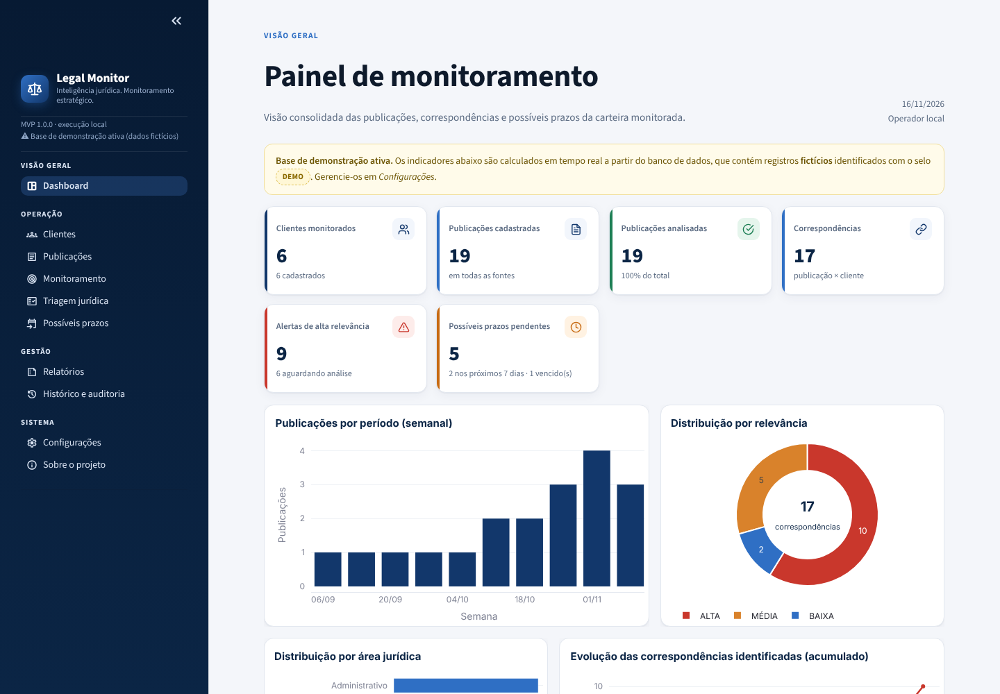
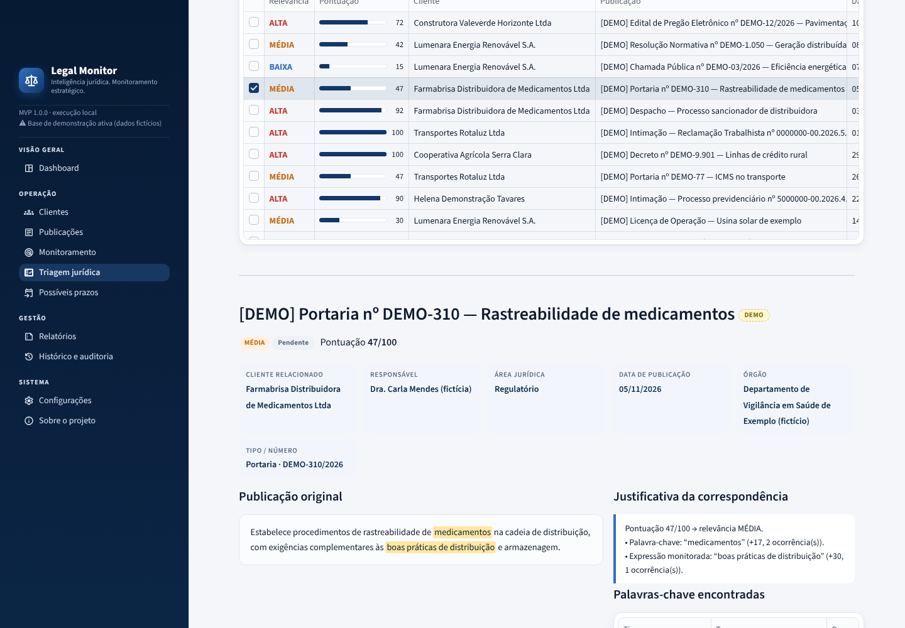
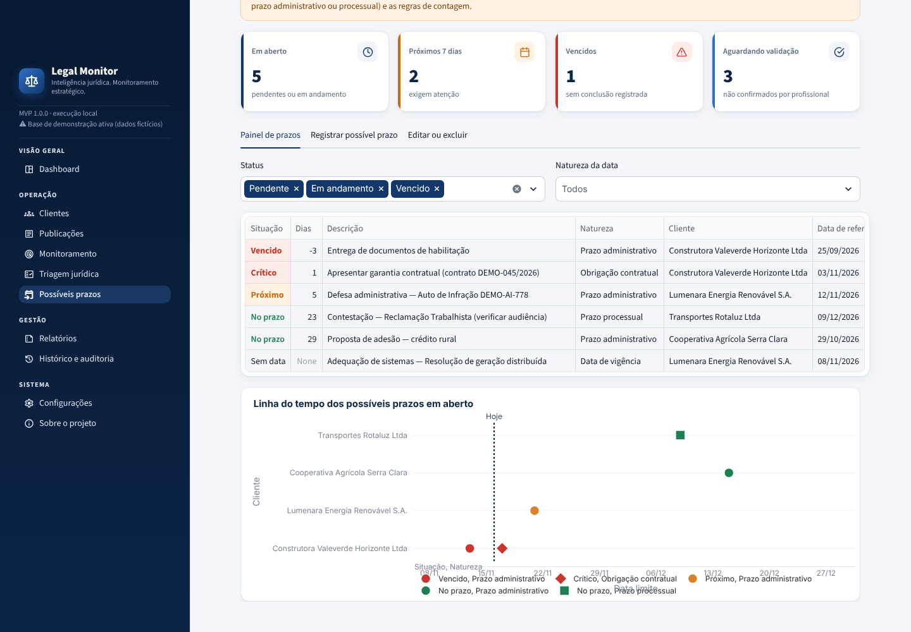
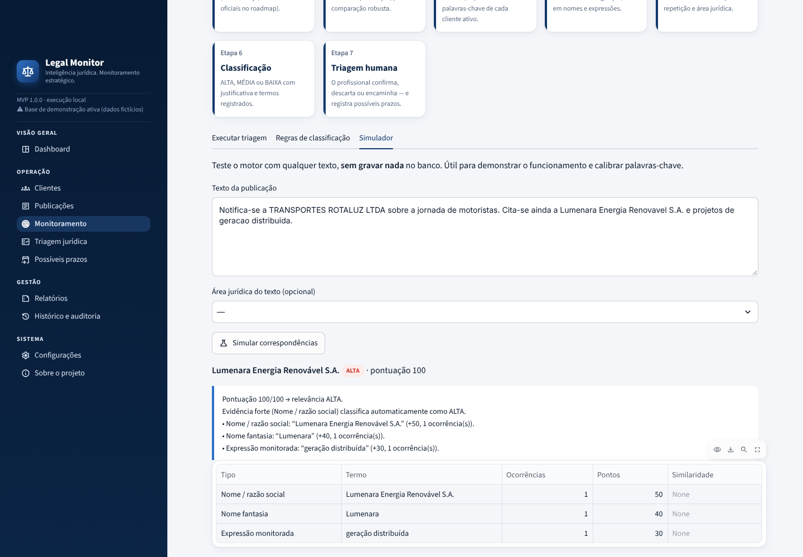
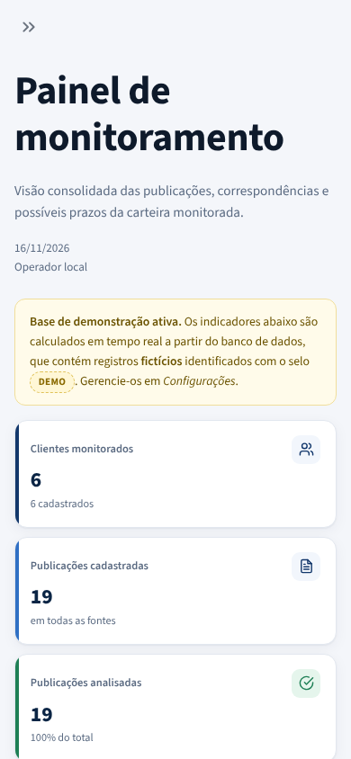

<div align="center">

# ⚖️ Legal Monitor

### Inteligência jurídica. Monitoramento estratégico.

Plataforma de monitoramento jurídico que identifica, classifica e acompanha publicações oficiais relevantes para clientes, empresas e departamentos jurídicos.




</div>

---

## Sumário

1. [Descrição executiva](#descrição-executiva)
2. [Problema identificado](#problema-identificado)
3. [Solução proposta](#solução-proposta)
4. [Objetivos](#objetivos)
5. [Funcionalidades](#funcionalidades)
6. [Tecnologias utilizadas](#tecnologias-utilizadas)
7. [Arquitetura](#arquitetura)
8. [Estrutura do repositório](#estrutura-do-repositório)
9. [Capturas de tela](#capturas-de-tela)
10. [Instalação](#instalação)
11. [Execução local](#execução-local)
12. [Dados demonstrativos](#dados-demonstrativos)
13. [Testes](#testes)
14. [Limitações conhecidas](#limitações-conhecidas)
15. [Roadmap](#roadmap)
16. [Contribuição](#contribuição)
17. [Licença](#licença)

---

## Descrição executiva

O **Legal Monitor** automatiza a etapa mais trabalhosa do acompanhamento jurídico de publicações oficiais: **descobrir o que importa**. A plataforma cruza o conteúdo de cada publicação com os dados dos clientes monitorados (nome, nome fantasia, CPF/CNPJ, palavras-chave e expressões), calcula uma **pontuação de relevância transparente**, registra **por que** cada alerta foi gerado e organiza a **triagem jurídica** e o controle de **possíveis prazos** — sempre com a decisão final nas mãos do profissional.

Esta versão (MVP 1.0) roda **localmente**, sem serviços pagos, e já entrega o fluxo completo: cadastro → monitoramento → triagem → prazos → relatórios → auditoria.

## Problema identificado

- **Volume:** diários oficiais publicam milhares de atos por dia, em várias fontes e formatos.
- **Risco:** uma publicação não identificada pode significar multa, perda de prazo ou oportunidade perdida.
- **Custo operacional:** a leitura manual é lenta, repetitiva e sujeita a falhas humanas.
- **Falta de rastreabilidade:** planilhas e e-mails não registram por que algo foi considerado relevante, nem quem decidiu.

## Solução proposta

| Etapa | O que o Legal Monitor faz |
|---|---|
| 1. Clientes | Cadastro de clientes, documentos e termos monitorados |
| 2. Publicações | Cadastro e consulta de publicações (captura automática prevista no roadmap) |
| 3. Motor de correspondência | Comparação exata, por expressões, por palavras-chave e aproximada |
| 4. Classificação | ALTA, MÉDIA ou BAIXA relevância por regras transparentes e configuráveis |
| 5. Triagem jurídica | Fila priorizada para confirmar, descartar ou encaminhar |
| 6. Possíveis prazos | Registro com natureza da data e validação profissional obrigatória |
| 7. Relatórios e auditoria | Exportação CSV/PDF e histórico completo de operações |

## Objetivos

- Reduzir o tempo de leitura e triagem de publicações oficiais.
- Diminuir o risco de não identificar uma publicação relevante.
- Tornar a classificação **explicável e auditável**.
- Separar com clareza **indícios automáticos** de **decisões profissionais**.
- Servir de base técnica para evoluir para uma plataforma **SaaS de LegalTech**.

## Funcionalidades

Tudo o que está listado abaixo **está implementado e funcionando** no MVP 1.0.

| Módulo | Recursos |
|---|---|
| **A. Dashboard** | Indicadores calculados do banco (clientes, publicações, analisadas, correspondências, alertas altos, prazos), gráficos de publicações por período, por área, por relevância e evolução acumulada das correspondências, além de publicações, prazos e atividades recentes |
| **B. Clientes** | CRUD completo; CPF/CNPJ com validação de dígitos verificadores; vários termos por cliente; bloqueio de duplicidade por documento ou por nome (ignora acentos e maiúsculas); status de monitoramento |
| **C. Publicações** | Cadastro, edição, exclusão, pesquisa sem acentos, filtros (período, área, fonte, tipo), leitura do texto integral com destaque dos termos, histórico por publicação e catálogo das fontes oficiais planejadas |
| **D. Motor de monitoramento** | Comparação por CPF/CNPJ, razão social (com e sem sufixo societário), nome fantasia, expressões e palavras-chave (respeitando limites de palavra), correspondência aproximada (tolerância a erros de digitação/OCR) e bônus por área jurídica. Execução idempotente, regras configuráveis pela interface e **simulador** que testa qualquer texto sem gravar no banco |
| **E. Triagem jurídica** | Fila filtrável; publicação original com termos destacados; justificativa; termos e pontos; status *Pendente / Em análise / Confirmada / Descartada / Encaminhada ao responsável*; observações; histórico de cada alteração |
| **F. Possíveis prazos** | Descrição, origem, cliente, natureza da data, data de referência, data limite sugerida, responsável, status, validação profissional; marcação automática de vencidos; alertas visuais (*Crítico*, *Próximo*, *Vencido*); linha do tempo; extração de **indícios** de datas e períodos no texto |
| **G. Relatórios** | Publicações, clientes, correspondências, alertas e possíveis prazos, com filtros por período, cliente, relevância e status. Exportação em **CSV** (separador `;` e codificação compatível com Excel) e **PDF** |
| **H. Histórico e auditoria** | Registro de cadastros, alterações (com diferenças campo a campo), exclusões, triagens, correspondências, mudanças de status e prazos, em linha do tempo cronológica com filtros e exportação |

### Como a relevância é calculada (regras padrão)

| Evidência encontrada | Pontos |
|---|---|
| CPF/CNPJ do cliente | 60 · **força ALTA** |
| Nome / razão social | 50 · **força ALTA** |
| Nome fantasia | 40 |
| Expressão monitorada (2 ou mais palavras) | 30 |
| Correspondência aproximada | até 20 (× similaridade) |
| Palavra-chave isolada | 15 |
| Área jurídica coincidente (apenas como complemento) | 10 |
| Cada repetição do mesmo termo | +2 (até +10 por termo) |

**ALTA** ≥ 50 · **MÉDIA** ≥ 25 · **BAIXA** ≥ 10 (pontuação limitada a 100). Todos os valores podem ser ajustados em *Monitoramento → Regras de classificação*. Detalhes em [`docs/features.md`](docs/features.md).

### Tratamento responsável de prazos

O sistema **não presume** que a data de publicação é o termo inicial de um prazo e **não trata** datas extraídas automaticamente como prazos definitivos. Cada registro informa a **natureza da data** (prazo processual, prazo administrativo, data de vigência, data de publicação, obrigação contratual ou outra) e indica se foi **validado por profissional responsável**.

## Tecnologias utilizadas

| Camada | Tecnologia |
|---|---|
| Linguagem | Python 3.11+ (testado com 3.13) |
| Interface | Streamlit (navegação multipágina, tema próprio e CSS) |
| Banco de dados | SQLite com SQLAlchemy 2 (ORM, consultas parametrizadas) |
| Validação | Pydantic 2 |
| Processamento | Pandas |
| Visualização | Plotly |
| Relatórios PDF | fpdf2 |
| Testes | Pytest |

## Arquitetura

```
┌────────────────────────── Interface (Streamlit) ──────────────────────────┐
│ app.py · modules/ (dashboard, clientes, publicações, monitoramento,       │
│ triagem, prazos, relatórios, histórico, configurações, sobre) · ui.py     │
└──────────────────────────────────┬────────────────────────────────────────┘
                                   │ objetos Pydantic (services/schemas.py)
┌──────────────────────── Serviços (regras de negócio) ─────────────────────┐
│ matching.py (motor puro) · classification.py (regras) · monitoring.py     │
│ client/publication/deadline_service.py · date_extraction.py               │
│ analytics.py · reports.py · audit.py                                      │
└───────────────┬──────────────────────────────────────────┬────────────────┘
                │ SQLAlchemy                               │ contratos
┌───────────────┴────────────┐               ┌─────────────┴──────────────┐
│ database/ (models, db,     │               │ integrations/ (INLABS,     │
│ schema.sql) → SQLite       │               │ DataJud, IA) — planejadas  │
└────────────────────────────┘               └────────────────────────────┘
```

- A interface **não acessa o banco diretamente**: toda regra de negócio fica em `services/`, pronta para ser exposta por uma API (FastAPI).
- O motor de correspondência é composto por **funções puras**, testáveis e reutilizáveis em workers.
- Os modelos não usam recursos exclusivos do SQLite, o que facilita migrar para **PostgreSQL**.

Mais detalhes em [`docs/architecture.md`](docs/architecture.md).

## Estrutura do repositório

```
legal-monitor/
├── app.py                    # Ponto de entrada (navegação e inicialização)
├── config.py                 # Configuração via variáveis de ambiente / .env
├── database/
│   ├── db.py                 # Engine, sessões transacionais, inicialização
│   ├── models.py             # Modelos ORM
│   └── schema.sql            # DDL de referência (gerado dos modelos)
├── modules/                  # Páginas da interface
│   ├── dashboard.py  clients.py  publications.py  monitoring.py
│   ├── triage.py  deadlines.py  reports.py  history.py
│   ├── settings.py  about.py
│   └── ui.py                 # Componentes visuais e tema
├── services/                 # Regras de negócio
│   ├── matching.py  classification.py  monitoring.py  analytics.py
│   ├── client_service.py  publication_service.py  deadline_service.py
│   ├── date_extraction.py  reports.py  audit.py
│   └── schemas.py  constants.py  text.py
├── integrations/             # Contratos e conectores planejados
│   ├── base.py  inlabs/  datajud/  ai/
├── data/demo_data.py         # Base demonstrativa fictícia
├── assets/style.css          # Identidade visual
├── tests/                    # 65 testes automatizados
├── docs/                     # Arquitetura, funcionalidades, roadmap, telas
├── .streamlit/config.toml    # Tema
├── .env.example  requirements.txt  LICENSE
```

## Capturas de tela

| Triagem jurídica | Possíveis prazos |
|---|---|
|  |  |

| Simulador do motor | Versão mobile |
|---|---|
|  |  |

## Instalação

Pré-requisitos: **Python 3.11 ou superior** e **Git**.

```bash
git clone https://github.com/oxelionel/legal-monitor.git
cd legal-monitor

python -m venv .venv
# Linux/macOS
source .venv/bin/activate
# Windows (PowerShell)
.venv\Scripts\Activate.ps1

pip install -r requirements.txt
cp .env.example .env      # opcional — os padrões já funcionam
```

## Execução local

```bash
streamlit run app.py
```

Acesse **http://localhost:8501**. Na primeira execução, o banco `data/legal_monitor.db` é criado automaticamente e, se estiver vazio, a base demonstrativa é carregada.

Variáveis disponíveis (`.env`):

| Variável | Padrão | Descrição |
|---|---|---|
| `LEGAL_MONITOR_DATABASE_URL` | `sqlite:///data/legal_monitor.db` | URL SQLAlchemy do banco |
| `LEGAL_MONITOR_USER` | `Operador local` | Nome registrado no histórico |
| `LEGAL_MONITOR_AUTO_SEED_DEMO` | `true` | Carrega a demonstração em banco vazio |
| `LEGAL_MONITOR_DEADLINE_ALERT_DAYS` | `7` | Antecedência do alerta de prazos |

## Dados demonstrativos

- 6 clientes, 19 publicações, 17 correspondências (ALTA, MÉDIA e BAIXA), 7 possíveis prazos e histórico de atividades.
- **Todos os registros são fictícios**: clientes, órgãos, números de processo e textos foram inventados. Publicações usam a fonte "Dados de demonstração", títulos iniciados por `[DEMO]` e aparecem com o selo **DEMO**.
- Não representam publicações oficiais reais. O único CNPJ usado (`11.222.333/0001-81`) é um número de exemplo comum em documentação.
- As datas são calculadas a partir do dia da carga, para que o painel sempre mostre um cenário atual.
- Em **Configurações** é possível **carregar, restaurar ou remover** a base demonstrativa sem afetar dados reais.

## Testes

```bash
pytest
```

65 testes cobrem: inicialização e persistência do banco, rollback, cadastro, alteração, duplicidade e exclusão de clientes, validações (CPF/CNPJ, e-mail, URL, datas), publicações e busca, identificação de palavras-chave, correspondência exata, aproximada e por documento, classificação de relevância, idempotência da triagem, preservação da análise humana, regras configuráveis, possíveis prazos e vencimento automático, extração de datas, indicadores, filtros de relatórios, exportação CSV e PDF, e carga ou remoção da base demonstrativa.

## Limitações conhecidas

- **Sem autenticação nem controle de acesso.** O MVP é indicado para uso local e demonstrações; o "usuário" do histórico é configurado por variável de ambiente.
- **Sem captura automática** de fontes oficiais: as publicações são cadastradas manualmente. Os conectores INLABS/DOU e DataJud estão apenas definidos como contratos.
- **Sem IA:** a classificação usa regras determinísticas. A correspondência aproximada é heurística e pode gerar falsos positivos ou negativos.
- **A extração de datas é indicativa**: não calcula prazos legais (dias úteis, feriados, suspensões, regras de intimação).
- **SQLite** é adequado para uso individual; uso concorrente exige PostgreSQL.
- **Segurança e privacidade:** os dados ficam sem criptografia no arquivo local. O projeto **não foi auditado quanto à conformidade com a LGPD**. Não utilize dados pessoais reais sem avaliação jurídica e técnica apropriada.

## Roadmap

| Versão | Situação | Entregas |
|---|---|---|
| **1.0** | ✅ Disponível | Fluxo completo local: cadastros, motor por regras, triagem, possíveis prazos, relatórios CSV/PDF, auditoria e demonstração |
| 1.1 | Planejado | Captura diária do DOU via INLABS, agendamento, notificações por e-mail |
| 1.2 | Planejado | Integração com o DataJud, vínculo com processos, calendário de feriados |
| 1.5 | Planejado | Autenticação e perfis, API REST (FastAPI), PostgreSQL |
| 2.0 | Visão | IA para resumo e classificação assistida, SaaS multi-inquilino |

Detalhes em [`docs/roadmap.md`](docs/roadmap.md).

## Contribuição

1. Crie uma branch a partir de `main` (`git checkout -b feature/minha-melhoria`).
2. Mantenha a separação de camadas: interface em `modules/`, regras em `services/`.
3. Adicione ou atualize testes e execute `pytest` antes de abrir o Pull Request.
4. Não versione `.env`, bancos de dados nem dados pessoais reais.
5. Descreva no PR o problema resolvido e como validar.

## Licença

Distribuído sob a licença **MIT**. Consulte [`LICENSE`](LICENSE).

> **Aviso:** o Legal Monitor é uma ferramenta de apoio. Classificações e possíveis prazos são sugestões automatizadas e devem ser validados por profissional habilitado, considerando a legislação e as regras aplicáveis ao caso.
